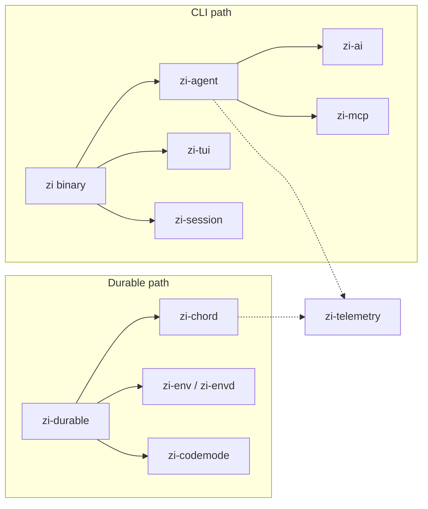

# zi

[English](README.md) · [中文](README.zh-CN.md)

`zi` is a **Rust-native coding agent** and durable agent harness: one binary for terminal, JSON/RPC automation, and a local multi-user Web UI — with WASM extensions, tight context budgets, and MCP.

It shares line-protocol contracts (Session v3, `AgentEvent`, MCP) with [pi](https://github.com/earendil-works/pi) where interoperability matters, but is a separate product: own brand (`zi` / `~/.zi`), own runtime, and features that go beyond a port.

[](LICENSE)
[](https://www.rust-lang.org/)

## Why zi

| Focus | What you get |
|-------|----------------|
| **Single Rust binary** | No Node runtime for the agent itself; `cargo install`-friendly, predictable deploy |
| **Five modes, one CLI** | `text` / `json` / `rpc` / `interactive` (TUI) / `web` — scripted or interactive from the same binary |
| **Local multi-user Web** | Built-in axum host + [`zi-web`](zi-web/) UI, token login, SQLite tenancy — not a thin wrapper around the TUI |
| **WASM extensions** | Users ship `extension.json` + `.wasm` next to a closed binary; builtins compile in and can be toggled |
| **Context & cost control** | LLM summarization compact, goal pin, token-aware fold/keep, explore budget, tool-output spill — aimed at Σ input, not only peak tokens |
| **Dual product paths** | **CLI** coding agent and **Durable** harness (`zi-durable` + `zi-chord` + `zi-env`) sharing AI types and telemetry |
| **Multi-provider** | Anthropic, OpenAI, DeepSeek, Z.AI / GLM, OpenRouter, Google — plus `~/.zi/agent/models.json` for custom endpoints |
| **Compatible where it counts** | Session v3 NDJSON, agent/stream events, MCP JSON-RPC — see [COMPAT](docs/COMPAT.md); paths and extensions are intentionally `zi`-native |

Inspired by pi’s package boundaries and contracts; not a drop-in rename of `pi`.

## Architecture (overview)



Details: [Architecture](docs/ARCHITECTURE.md) · [Crates](docs/CRATES.md)

## Quick start

```bash
# Build
cargo build --workspace

# Help
cargo run -p zi-coding-agent -- --help

# One-shot (API key via export, .env, or ~/.zi/agent/.env)
cargo run -p zi-coding-agent -- --model deepseek-flash -p "Summarize this repo in one sentence" --no-session

# Smoke
./evals/smoke.sh
```

Without `-p` and with a TTY stdin, zi opens the interactive TUI; use `--mode interactive` to force it. Custom endpoints: copy [`models.json.example`](models.json.example) to `~/.zi/agent/models.json` — see [MODELS.md](docs/MODELS.md).

```bash
# Local Web UI (default 127.0.0.1:3080)
cargo run -p zi-coding-agent -- web seed-user alice
cargo run -p zi-coding-agent -- --mode web --no-open
```

## Documentation

| Doc | Contents |
|-----|----------|
| [Getting started](docs/GETTING_STARTED.md) | Env, API keys, first run |
| [Architecture](docs/ARCHITECTURE.md) | Dual paths, dependency graph, event flow |
| [CLI](docs/CLI.md) | Modes, flags, RPC, web |
| [Web UI](docs/WEB.md) | Token auth, SQLite, REST/WS |
| [Configuration](docs/CONFIGURATION.md) | `~/.zi/`, sessions, env vars |
| [Extensions](docs/EXTENSIONS.md) | WASM / host pack → use in zi |
| [Models](docs/MODELS.md) | Built-in catalog, `.env`, `models.json` |
| [Crates](docs/CRATES.md) | Crate roles vs pi packages |
| [Session format](docs/SESSION.md) | Session v3 NDJSON |
| [Compatibility](docs/COMPAT.md) | Protocol alignment and intentional diffs |
| [Development](docs/DEVELOPMENT.md) | Build, test, images, xtask |

Index: [`docs/README.md`](docs/README.md). Technical docs are primarily in Chinese; identifiers stay English. Product overview in Chinese: [README.zh-CN.md](README.zh-CN.md).

## Relation to pi

| Topic | pi | zi |
|-------|----|----|
| Config root | `~/.pi/`, `.pi/` | `~/.zi/`, `.zi/` (project resources need `/trust`) |
| CLI | `pi` (npm) | `zi` (Cargo / single binary) |
| Extensions | TS/JS (jiti) | External WASM for end users; builtins in-binary; skills / prompts / themes as files |
| Env sync line | `PI-ENV` | `ZI-ENV` (not interchangeable) |
| Model catalog | Generated TS + `models.json` | Static subset + `~/.zi/agent/models.json` |
| Web / durable | Separate concerns in the TS stack | First-class `web` mode + Durable crates in this workspace |

Session v3, `AgentEvent`, `AssistantMessageEvent`, and MCP JSON-RPC follow [COMPAT](docs/COMPAT.md).

## License

[MIT](LICENSE) — same as workspace `Cargo.toml`.
