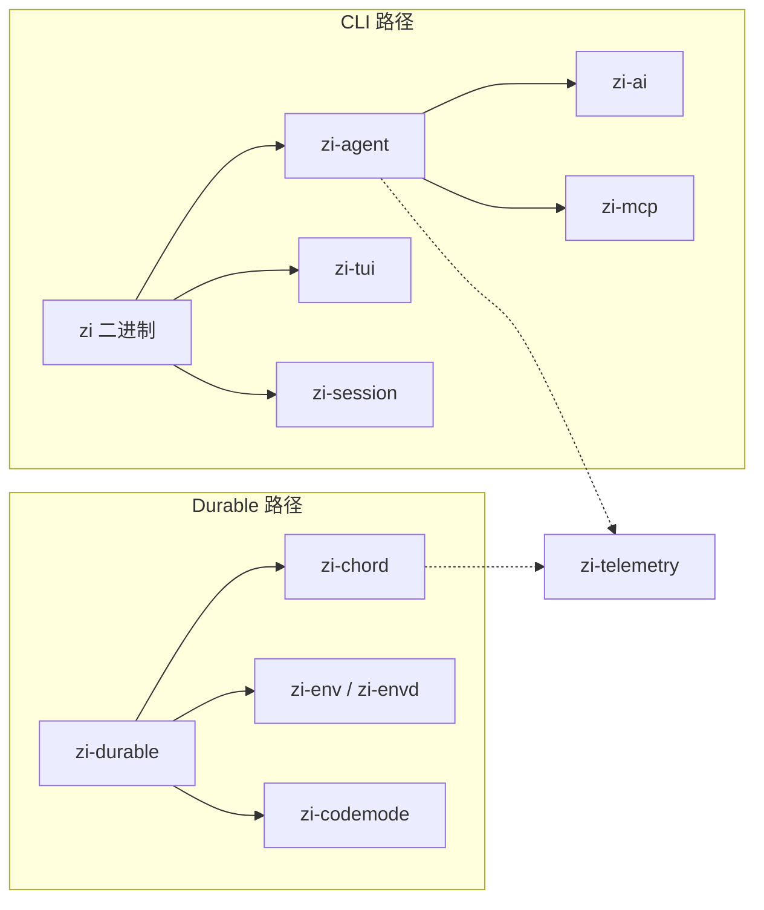

# zi

[pi](https://github.com/earendil-works/pi) coding-agent 栈的 Rust 重写。产品命名、配置路径与 CLI 二进制均使用 **zi**（不再使用 `pi-` 前缀）。



## 快速开始

```bash
# 构建
cargo build --workspace

# 帮助
cargo run -p zi-coding-agent -- --help

# 单次提问（API Key 可 export 或写在 .env / ~/.zi/agent/.env）
cargo run -p zi-coding-agent -- --model deepseek-flash -p "用一句话概括本仓库" --no-session

# 冒烟
./evals/smoke.sh
```

无 `-p` 且 stdin 为 TTY 时进入交互式 TUI；也可用 `--mode interactive` 强制进入。自定义端点：复制 [`models.json.example`](models.json.example) 到 `~/.zi/agent/models.json`，详见 [MODELS.md](docs/MODELS.md)。

## 文档

技术文档集中在 [`docs/`](docs/README.md)：

| 文档 | 内容 |
|------|------|
| [入门](docs/GETTING_STARTED.md) | 环境、API Key、第一次运行 |
| [架构](docs/ARCHITECTURE.md) | 双路径、依赖图、事件流 |
| [CLI](docs/CLI.md) | 模式、参数、RPC、web |
| [Web UI](docs/WEB.md) | token 登录、SQLite、REST/WS |
| [配置与路径](docs/CONFIGURATION.md) | `~/.zi/`、会话、环境变量 |
| [扩展开发](docs/EXTENSIONS.md) | 从 0 写 WASM / host pack 到在 zi 里使用 |
| [模型](docs/MODELS.md) | 内置目录、`.env`、`models.json` |
| [Crates](docs/CRATES.md) | 各 crate 职责与对应 pi 包 |
| [会话格式](docs/SESSION.md) | Session v3 NDJSON |
| [兼容性](docs/COMPAT.md) | 与 pi 的协议对齐与差异 |
| [开发](docs/DEVELOPMENT.md) | 构建、测试、镜像、xtask |

## 与 pi 的主要差异

| 主题 | pi | zi |
|------|----|----|
| 配置根 | `~/.pi/`、`.pi/` | `~/.zi/`、`.zi/`（项目资源需 `/trust`） |
| CLI | `pi`（npm） | `zi`（Cargo） |
| 扩展 | TS/JS（jiti） | 用户仅 bin：外部目录 WASM；builtins 编进二进制可开关；skills / prompts / themes 为文件资源 |
| Env 同步行 | `PI-ENV` | `ZI-ENV`（不可混用） |
| 模型目录 | 生成 TS + `models.json` | 静态子集 + `~/.zi/agent/models.json` |

会话 v3、`AgentEvent`、`AssistantMessageEvent`、MCP JSON-RPC 以 [兼容性文档](docs/COMPAT.md) 为准。

## 许可证

MIT（与 workspace `Cargo.toml` 一致）。
