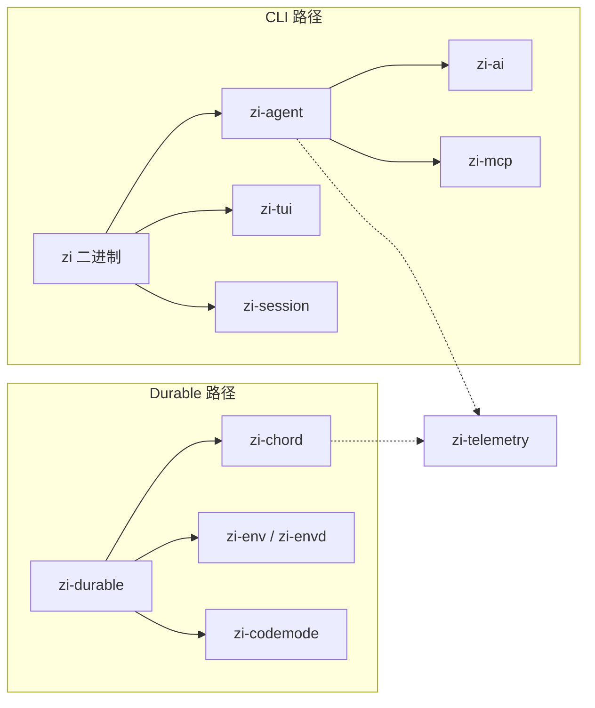

# zi

[English](README.md) · [中文](README.zh-CN.md)

`zi` 是用 **Rust** 实现的本地 coding agent 与 durable harness：一个二进制覆盖终端、JSON/RPC 自动化与本地多用户 Web；扩展走 WASM，并内置偏实战的上下文 / token 预算策略。

在会话格式、`AgentEvent`、MCP 等**可互操作合同**上与 [pi](https://github.com/earendil-works/pi) 对齐；产品本身独立——命名、配置根与运行时均为 **zi**，并带有不止「重写」的能力。

[](LICENSE)
[](https://www.rust-lang.org/)

## 为什么选 zi

| 侧重 | 说明 |
|------|------|
| **单二进制** | Agent 本体不依赖 Node；便于部署与分发 |
| **五模式一体** | `text` / `json` / `rpc` / `interactive`（TUI）/ `web` |
| **本地多用户 Web** | axum 宿主 + [`zi-web`](zi-web/)，token 登录、SQLite 租户隔离 |
| **WASM 扩展** | 用户侧只需 `extension.json` + `.wasm`；builtin 编进二进制可开关 |
| **上下文与成本** | LLM 摘要 compact、Goal pin、按 token fold/keep、探索预算、大输出 spill —— 压的是 Σ input |
| **双产品路径** | **CLI** coding agent 与 **Durable**（`zi-durable` + `zi-chord` + `zi-env`）共享 AI 类型与 telemetry |
| **多模型** | Anthropic / OpenAI / DeepSeek / 智谱 Z.AI / OpenRouter / Google，以及自定义 `models.json` |
| **该对齐的对齐** | Session v3、事件流、MCP；路径与扩展体系刻意 `zi` 化 —— 见 [COMPAT](docs/COMPAT.md) |

吸收了 pi 的包边界与协议经验，但不是 `pi` 的换皮。

## 架构概览



详情：[架构](docs/ARCHITECTURE.md) · [Crates](docs/CRATES.md)

## 快速开始

```bash
# 构建
cargo build --workspace

# 帮助
cargo run -p zi-coding-agent -- --help

# 单次提问（API Key 可 export 或写在 .env / ~/.zi/agent/.env）
cargo run -p zi-coding-agent -- --model deepseek-flash -p "用一句话概括本仓库" --no-session

# 冒烟
./evals/smoke.sh
```

无 `-p` 且 stdin 为 TTY 时进入交互式 TUI；也可用 `--mode interactive` 强制进入。自定义端点：复制 [`models.json.example`](models.json.example) 到 `~/.zi/agent/models.json`，详见 [MODELS.md](docs/MODELS.md)。

```bash
# 本地 Web（默认 127.0.0.1:3080）
cargo run -p zi-coding-agent -- web seed-user alice
cargo run -p zi-coding-agent -- --mode web --no-open
```

## 文档

技术文档集中在 [`docs/`](docs/README.md)：

| 文档 | 内容 |
|------|------|
| [入门](docs/GETTING_STARTED.md) | 环境、API Key、第一次运行 |
| [架构](docs/ARCHITECTURE.md) | 双路径、依赖图、事件流 |
| [CLI](docs/CLI.md) | 模式、参数、RPC、web |
| [Web UI](docs/WEB.md) | token 登录、SQLite、REST/WS |
| [配置与路径](docs/CONFIGURATION.md) | `~/.zi/`、会话、环境变量 |
| [扩展开发](docs/EXTENSIONS.md) | WASM / host pack 到在 zi 里使用 |
| [模型](docs/MODELS.md) | 内置目录、`.env`、`models.json` |
| [Crates](docs/CRATES.md) | 各 crate 职责与对应 pi 包 |
| [会话格式](docs/SESSION.md) | Session v3 NDJSON |
| [兼容性](docs/COMPAT.md) | 与 pi 的协议对齐与差异 |
| [开发](docs/DEVELOPMENT.md) | 构建、测试、镜像、xtask |

英文产品概览见 [README.md](README.md)。

## 与 pi 的关系

| 主题 | pi | zi |
|------|----|----|
| 配置根 | `~/.pi/`、`.pi/` | `~/.zi/`、`.zi/`（项目资源需 `/trust`） |
| CLI | `pi`（npm） | `zi`（Cargo / 单二进制） |
| 扩展 | TS/JS（jiti） | 用户侧外部 WASM；builtins 编进二进制可开关；skills / prompts / themes 为文件资源 |
| Env 同步行 | `PI-ENV` | `ZI-ENV`（不可混用） |
| 模型目录 | 生成 TS + `models.json` | 静态子集 + `~/.zi/agent/models.json` |
| Web / Durable | TS 栈中另有侧重 | 本仓库一等公民：`web` 模式 + Durable crates |

会话 v3、`AgentEvent`、`AssistantMessageEvent`、MCP JSON-RPC 以 [兼容性文档](docs/COMPAT.md) 为准。

## 许可证

[MIT](LICENSE)（与 workspace `Cargo.toml` 一致）。
