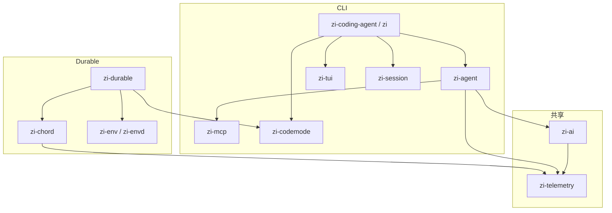
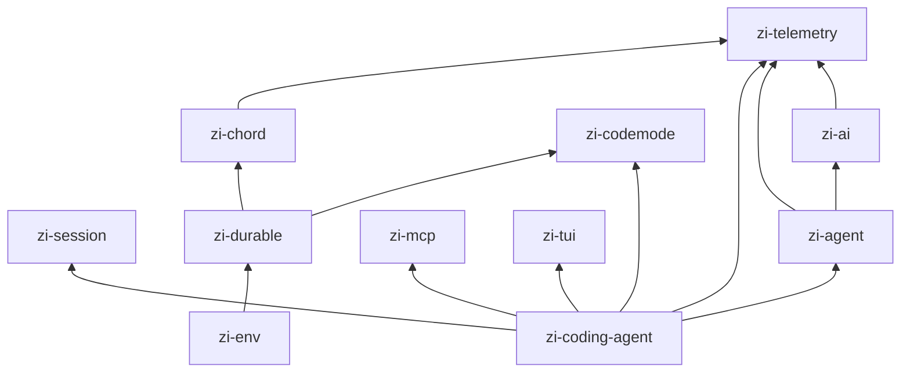
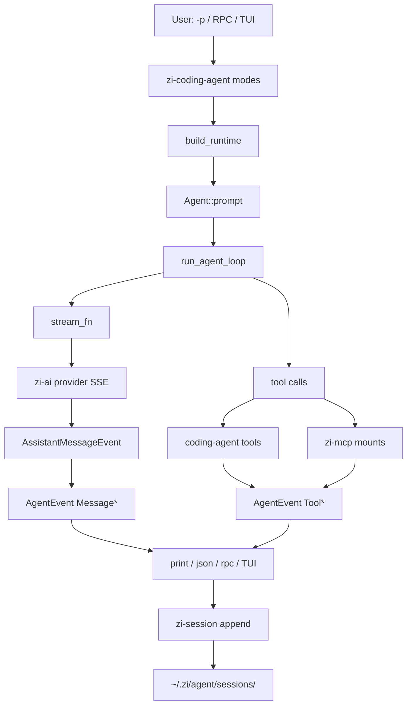
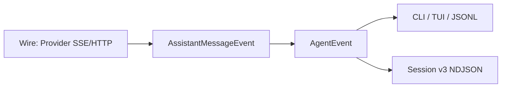
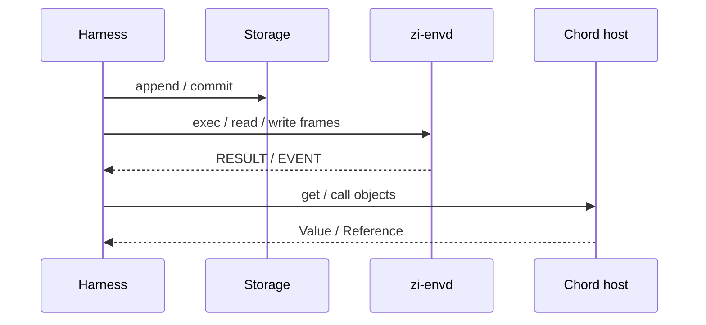

# 架构

zi 是按 pi monorepo 包边界组织的 Rust workspace。两条产品路径共享 telemetry 与 AI 类型：

1. **CLI 路径** — 本地 coding agent（二进制 `zi`）。
2. **Durable 路径** — 托管 harness（`zi-durable` + `zi-chord` + `zi-env`）。

## 双路径总览

## Crate 依赖（简化）

| Crate | 角色 |
|-------|------|
| `zi-telemetry` | 追踪/指标上下文（CLI 默认 NOOP） |
| `zi-session` | Session v3 NDJSON 读写与迁移 |
| `zi-ai` | 模型、Provider HTTP/SSE、`AssistantMessageEvent` |
| `zi-agent` | Agent 循环、工具、`AgentEvent` 广播 |
| `zi-mcp` | MCP 客户端（stdio、streamable HTTP） |
| `zi-codemode` | QuickJS codemode DSL 宿主 |
| `zi-tui` | 终端 UI 与交互驱动 |
| `zi-coding-agent` | `zi` CLI：print / json / rpc / interactive |
| `zi-chord` | Chord v2 风格 host / store / contracts |
| `zi-durable` | Harness、compaction、memory/jsonl/sqlite |
| `zi-env` | `zi-envd` 与本地/远程执行客户端 |

更细的对照见 [CRATES.md](./CRATES.md)。

## 数据流：prompt → tools → events

### 事件分层

1. **Wire** — 各厂商 chunk，在 `zi-ai` adapter 内归一化。
2. **AssistantMessageEvent** — 流式 partial assistant message。
3. **AgentEvent** — 回合生命周期、工具执行、终态消息；UI 与 `--mode json` 消费。
4. **Session entries** — 持久化的 `message` 等 v3 行。

## Durable 路径（摘要）

`zi-durable` 提供可插拔存储；`zi-env` 通过帧协议做沙箱文件/执行；`zi-chord` 提供长生命周期协调原语（对齐 pi Chord v2 slice）。

## 相关文档

- [COMPAT.md](./COMPAT.md) — 跨语言合同
- [SESSION.md](./SESSION.md) — 会话格式
- [CLI.md](./CLI.md) — 用户入口行为
