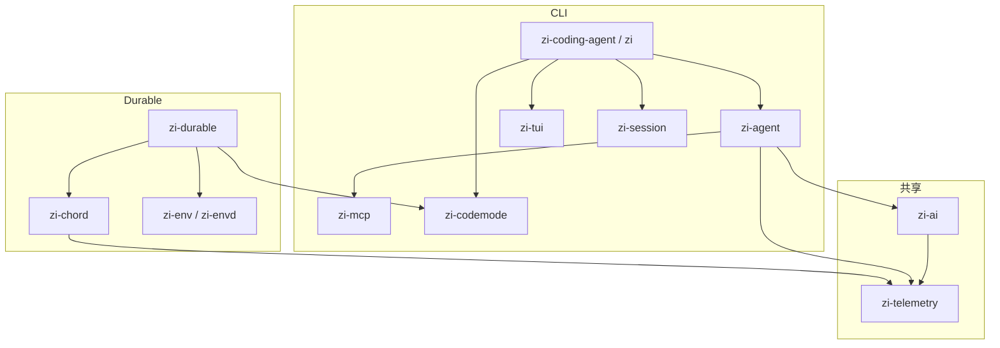
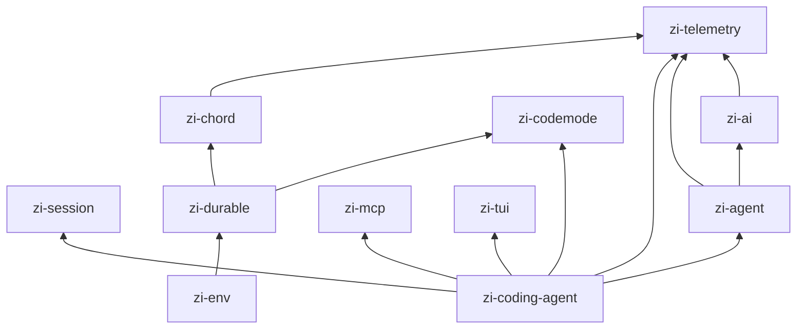
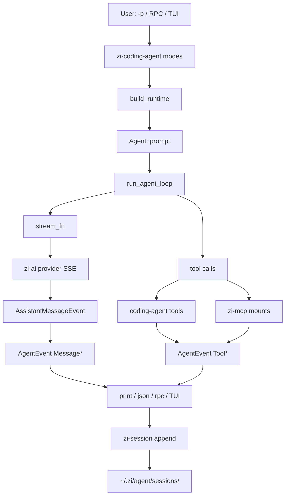
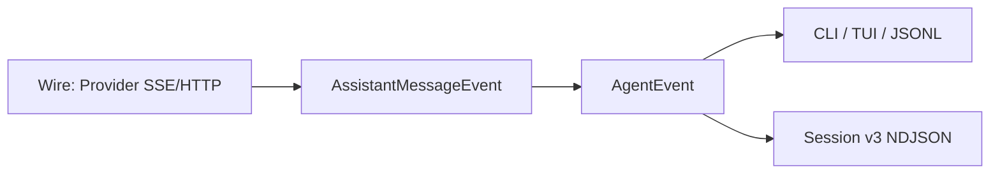
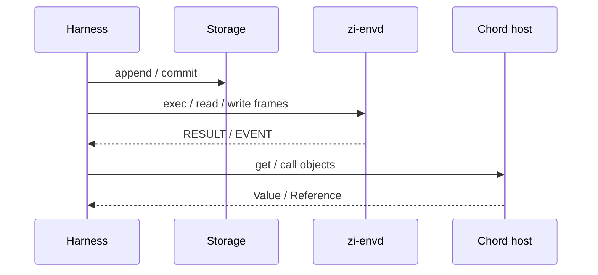

# 架构

zi 是按 pi monorepo 包边界组织的 Rust workspace。两条产品路径共享 telemetry 与 AI 类型：

1. **CLI 路径** — 本地 coding agent（二进制 `zi`）。
2. **Durable 路径** — 托管 harness（`zi-durable` + `zi-chord` + `zi-env`）。

## 双路径总览

## Crate 依赖（简化）

| Crate | 角色 |
|-------|------|
| `zi-telemetry` | 追踪/指标上下文（CLI 默认 NOOP） |
| `zi-session` | Session v3 NDJSON 读写与迁移 |
| `zi-ai` | 模型、Provider HTTP/SSE、`AssistantMessageEvent` |
| `zi-agent` | Agent 循环、工具、`AgentEvent` 广播 |
| `zi-mcp` | MCP 客户端（stdio、streamable HTTP） |
| `zi-codemode` | QuickJS codemode DSL 宿主 |
| `zi-tui` | 终端 UI 与交互驱动 |
| `zi-coding-agent` | `zi` CLI：print / json / rpc / interactive |
| `zi-chord` | Chord v2 风格 host / store / contracts |
| `zi-durable` | Harness、compaction、memory/jsonl/sqlite |
| `zi-env` | `zi-envd` 与本地/远程执行客户端 |

更细的对照见 [CRATES.md](./CRATES.md)。

## 上下文预算（token 控制）

对标 Cursor：压的是 **Σ input（轮次 × 近峰值）**，不只单次峰值。DeepSeek 上 `prompt_tokens = cache_hit + cache_miss`（命中更便宜，但仍计入总量）。

- **LLM 摘要 compact**：auto 与 `/compact`（`/summarize`）优先用无 tools 单次补全生成 Goal/Progress/Next Steps 摘要；失败回退机械截断。摘要前 transcript 可写入 `~/.zi/agent/transcript-archive/`，摘要内给路径供 `read` 回搜。
- **Goal pin**：机械回退路径强制保留最近真实用户目标（`<pinned-goal>`）；edit/write/explore 成功仍 pin。
- **Fold / keep 按 token**：近窗 tool 结果默认 ≤8k tok 全文；compact keep 尾默认 ≤12k tok（非固定条数）。edit/write/explore 不 fold。
- **触发阈值**：估算 ≥ `min(context_window × 0.90, 48k)` 时 compact。
- **探索预算**：自上次用户消息起，父会话 **`ls/find/grep`**（不含 `read`）超 10 次附加提示，超 16 次硬拒（仍允许 explore/edit/write/bash/read）；`explore_budget_block/warn = 0` 表示禁用。**explore 子循环关闭该预算**（容量靠 `max_turns`）；父会话**成功 explore 后重置**计数。`read` 不计预算，避免核对 Key paths 时连红。
- **AGENTS / skills 税**：AGENTS.md 注入单文件 ~2KB、总块 ~4KB 截断并给 read 指针；skills 仅短目录（name + ≤120 字描述 + path）。
- **稳定前缀**：system 为稳定路由说明；AGENTS/skills/append 进 `<session-context>` user，利于前缀缓存。
- **主会话工具**：静态 read/grep/find/ls/bash/edit/write；**explore 延迟挂载**（schema 始终广告，首次调用时装入 active；也写入 SharedToolList 供 codemode）。bash 硬拦树探索。grep 优先 `rg`，缺省回退系统 `grep -R`（排除 target/node_modules/.git 等；20s 超时；stdout 满 limit 即杀进程）。架构回答须引用工具读到的路径；UNKNOWN 仅在工具失败或路径确认缺失时使用。
- **Read**：默认 120 行；行号每 10 行；截断提示带下一 `offset`。
- **Web 步骤标签**：Read / Grepped / Search files / Listed / Explored / Ran command / Edited / Wrote；Thought。ContextRing 显示 estimated/compact limit%。
- **TUI 状态栏**：同一 `ContextUsage` 事件写入 footer `extra`（`ctx N% · est/limit · fold · Σin→out`）；compact 时打一行 system 提示。Agent 侧预算/explore/fold 与 web 共用 `build_runtime`。
- **Spill**：大 tool 输出 → `tool-outputs/` 指针。
- **Cache 映射**：OpenAI-completions 读取 `prompt_cache_hit_tokens` → `usage.cache_read`；miss 计入 `input`（DeepSeek 会计）。Anthropic 仍用 `cache_control: ephemeral`。

## 数据流：prompt → tools → events

### 事件分层

1. **Wire** — 各厂商 chunk，在 `zi-ai` adapter 内归一化。
2. **AssistantMessageEvent** — 流式 partial assistant message。
3. **AgentEvent** — 回合生命周期、工具执行、终态消息；UI 与 `--mode json` 消费。
4. **Session entries** — 持久化的 `message` 等 v3 行。

## Durable 路径（摘要）

`zi-durable` 提供可插拔存储；`zi-env` 通过帧协议做沙箱文件/执行；`zi-chord` 提供长生命周期协调原语（对齐 pi Chord v2 slice）。

## 相关文档

- [COMPAT.md](./COMPAT.md) — 跨语言合同
- [SESSION.md](./SESSION.md) — 会话格式
- [CLI.md](./CLI.md) — 用户入口行为
