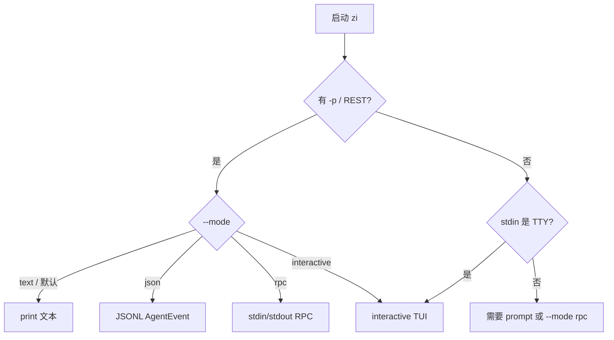
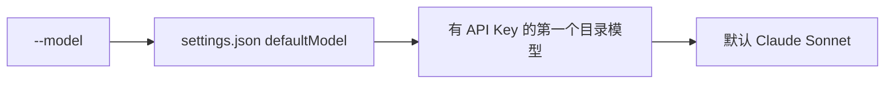

# CLI（`zi`）

二进制来自 `zi-coding-agent`，包名 crate、二进制名 **`zi`**。

```bash
cargo run -p zi-coding-agent -- [OPTIONS] [REST]...
```

## 模式选择



| `--mode` | 行为 |
|----------|------|
| `text`（默认） | 有 prompt → print；无 prompt 且 TTY → interactive |
| `json` |  stdout 输出 JSONL `AgentEvent` |
| `rpc` | 行协议：`prompt` / `abort` 等 |
| `interactive` | 强制 TUI（需要 TTY） |

## 常用参数

| 参数 | 含义 |
|------|------|
| `-p` / `--print <PROMPT>` | 单次提示词 |
| `[REST]...` | 未给 `-p` 时，用空格拼接作为 prompt |
| `--mode <MODE>` | 见上表 |
| `--model <ID>` | 内置目录或 `models.json`（如 `deepseek-flash`、`claude-sonnet-4-20250514`）；未知 id 报错 |
| `--cwd <PATH>` | 工具工作目录与会话 cwd 编码 |
| `--no-session` | 不写 `~/.zi/agent/sessions/` |

## Print 模式

人类可读 stdout：助手文本增量 + 工具活动摘要。

```bash
cargo run -p zi-coding-agent -- -p "列出 src 下的模块" --cwd .
```

## JSON 模式

每行一个 `AgentEvent`（serde 外部标签，`type` 为 snake_case）。适合管道与自动化。

```bash
cargo run -p zi-coding-agent -- --mode json -p "ping" --no-session
```

事件形状见 [COMPAT.md](./COMPAT.md#agentevent)。

## RPC 模式

stdin/stdout JSONL。典型命令：`prompt`、`abort`。用于宿主进程嵌入。

```bash
cargo run -p zi-coding-agent -- --mode rpc --no-session
```

## Interactive（TUI）

```bash
cargo run -p zi-coding-agent -- --mode interactive
```

以 `/` 开头的行在进 LLM **之前**由本地 slash 命令处理：

| 命令 | 说明 |
|------|------|
| `/model` / `/models` | 列出模型；`/model <id>` 切换 |
| `/hotkeys` / `/help` | 快捷键与命令列表 |
| `/copy` | 复制最近一条助手回复到系统剪贴板 |
| `/quit` / `/exit` | 退出 |

打 `/` 可模糊补全（Tab 确认，↑↓ 选择）。未知 slash 显示错误提示，不会发给模型。

转录区可用终端**鼠标拖选**复制（未启用 mouse capture）；也可 `Ctrl+Y` 或 `/copy` 复制最近回复。

库入口：`zi_coding_agent::run_interactive_mode`（及 `run_interactive_with`）。TUI 实现在 `zi-tui`。

## 模型解析顺序



密钥解析见 `zi-ai` 的 `get_env_api_key` / `require_api_key`。
