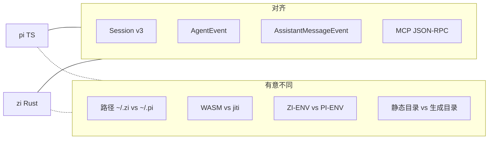

# 协议兼容性（zi ↔ pi）

zi 在存在共享合同时，目标是与参考栈 [pi](https://github.com/earendil-works/pi) **线协议兼容**。品牌、配置根与扩展加载不同（见 [CONFIGURATION.md](./CONFIGURATION.md)）。

## Session v3 NDJSON

| 区域 | pi (TS) | zi (Rust) | 备注 |
|------|---------|-----------|------|
| 文件布局 | `~/.pi/agent/sessions/--<cwd>--/<ts>_<id>.jsonl` | `~/.zi/agent/sessions/--…` | 编码规则相同 |
| Header | `{"type":"session","version":3,…}` | 相同 | `zi-session` |
| Entry `type` | snake_case | 相同 | `zi_session::SessionEntry` |
| Legacy v1/v2 | 加载时迁移 | 加载时迁移 | 如 `hookMessage` → `custom` |
| 交叉读取 | `~/.pi` | `~/.zi` | 不自动共享；可复制/软链对比 |

参考：pi [session-format.md](https://github.com/earendil-works/pi/blob/main/packages/coding-agent/docs/session-format.md)。本地摘要：[SESSION.md](./SESSION.md)。

## AgentEvent

序列化 `"type": "<snake_case>"`（serde 外部标签）。

| Event | pi `packages/agent` | zi `zi-agent` | 状态 |
|-------|---------------------|---------------|------|
| `agent_start` / `agent_end` | Yes | Yes | 对齐 |
| `turn_start` / `turn_end` | Yes | Yes | 对齐 |
| `message_start` / `message_update` / `message_end` | Yes | Yes | 对齐 |
| `tool_execution_start` / `_update` / `_end` | Yes | Yes | 对齐 |

CLI `--mode json` / `--mode rpc` 在 stdout 以 JSONL 输出。

## AssistantMessageEvent

| Event | pi `packages/ai` | zi `zi-ai` | 状态 |
|-------|------------------|------------|------|
| `start` | Yes | Yes | 对齐 |
| `text_start` / `text_delta` / `text_end` | Yes | Yes | 对齐 |
| `thinking_*` | Yes | Yes | 视 Provider 支持 |
| `toolcall_start` / `toolcall_delta` / `toolcall_end` | Yes | Yes | 对齐 |
| `done` / `error` | Yes | Yes | 对齐 |

zi 后端：Anthropic Messages、OpenAI Completions、OpenAI Responses、Google Generative AI（目录子集）。

## MCP

| 区域 | pi | zi | 状态 |
|------|----|----|------|
| JSON-RPC 2.0 | Yes | Yes | 对齐 |
| stdio | Yes | Yes | |
| Streamable HTTP | Yes | Yes | |
| OAuth | Yes | feature `oauth` | 可选 |
| Tool → LLM 描述 | Yes | Yes | 默认 `mcp_` 前缀挂载 |

## Execution environment

| 区域 | pi | zi | 状态 |
|------|----|----|------|
| 守护进程 | `pi-envd` | `zi-envd` | 更名 |
| 同步行 | `PI-ENV <token>` | `ZI-ENV <token>` | **不可互换** |
| Protocol | `1` | `1` | 同语义 |
| 帧协议 | REQUEST/RESULT/EVENT/… | 相同集合声明 | 表面子集 |

必须用 `zi-env` 客户端对接 `zi-envd`；不要把 pi 客户端直接指向 zi-envd（除非改同步前缀）。

## 环境变量命名

| 用途 | pi | zi |
|------|----|----|
| Agent 根 | `PI_AGENT_DIR`（若使用） | `ZI_AGENT_DIR` |
| Provider keys | `ANTHROPIC_API_KEY` 等 | 相同 |
| 日志 | pi 惯例 | `RUST_LOG` / tracing `EnvFilter` |

## 有意差异

- **扩展**：pi 用 jiti 加载 TS/JS；zi 为统一发现（`extension.json`）+ 双轨执行：`kind: builtin`（`HostExtensionPack`）与 `kind: wasm`（ABI v1：command / notify / widget + agent hooks）。项目扩展需 `/trust`；`/reload` 重建 host packs 与 prompts/skills（WASM 字节热替换需重启）。
- **产品路径**：`~/.zi/`、`.zi/`。
- **模型目录**：pi 生成全量 catalog；zi 静态子集 + `~/.zi/agent/models.json`（pi models.json 的字段子集：`baseUrl` / `api` / `apiKey` / `models[]`；无 `compat` / `headers` / `!cmd` / `auth.json`）。
- **`.env`**：zi CLI 启动时加载 `cwd/.env` 与 `agent_dir/.env`（不覆盖已有进程 env）。

## 资源加载（与 pi 对齐的子集）

| 资源 | zi 状态 |
|------|---------|
| prompts | `~/.zi/agent/prompts`、信任后的 `.zi/prompts` → 同名 slash |
| skills | 目录发现 + `/skill:name`；含 `~/.agents/skills` |
| themes | 内置 dark/light + JSON；`/theme` |
| mcp.json | 启动连接；`/mcp` |
| AGENTS.md / SYSTEM.md | 写入 system prompt |
| project trust | `trusted.json` + `/trust` |
| packages | `settings.packages` + `npm/`/`git/` 约定目录 |
| extensions | 用户仅有 bin 时靠 **WASM** 动态加装：`~/.zi/agent/extensions/<id>/`（`extension.json` + `.wasm`）；项目 `.zi/extensions/` 需 trust。默认 feature 含 `wasm-extensions`。builtin host pack 编进二进制，用户只能开关已内置 id；构建机源码默认 `~/.zi/host-extensions`。`/extensions`、`/reload`（不热替换 wasm 字节）。见 [EXTENSIONS.md](./EXTENSIONS.md) |
