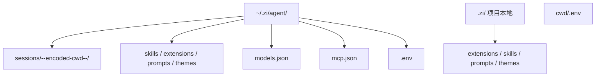
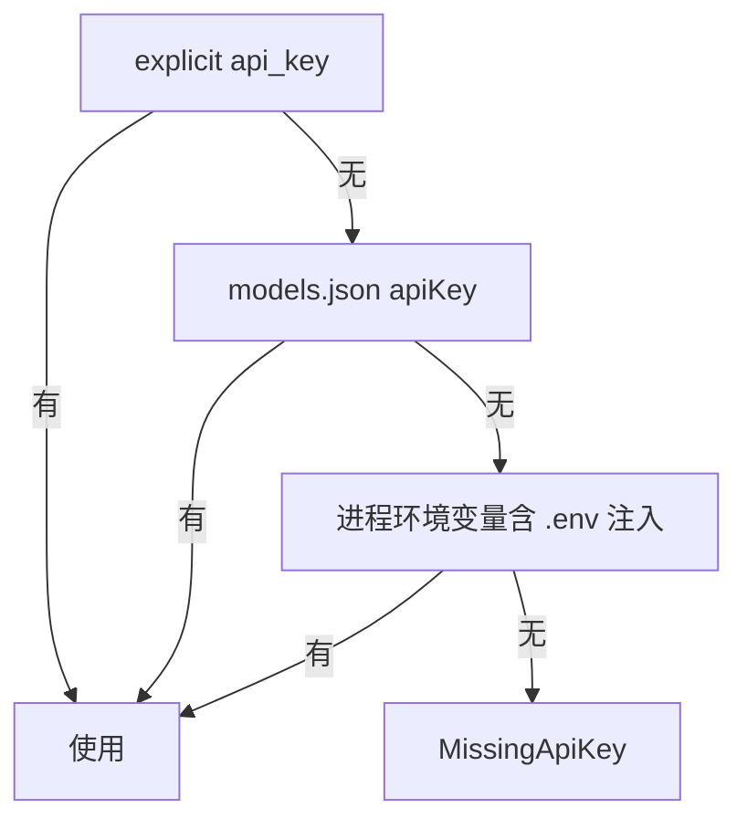

# 配置与路径

## 目录布局



| 路径 | 用途 |
|------|------|
| `~/.zi/host-extensions/` | **构建期** host pack 源码 crate（默认；可用 `ZI_HOST_EXTENSIONS_PATH` 覆盖，见下） |
| `~/.zi/agent/` | Agent 配置根（settings、auth、sessions、skills、extensions、prompts、themes、mcp.json、models.json、.env、keybindings.json、trusted.json） |
| `~/.zi/agent/models.json` | 自定义 / 覆盖 provider 与模型（见 [MODELS.md](./MODELS.md)；示例：仓库根 [`models.json.example`](../models.json.example)） |
| `~/.zi/agent/settings.json` | 偏好：`defaultModel`、`theme`、`packages` |
| `~/.zi/agent/mcp.json` | MCP 服务器（stdio / HTTP）；启动时连接并挂载为 `mcp_<server>_<tool>` |
| `~/.zi/agent/prompts/` | Prompt 模板 → 同名 slash（如 `/explain`） |
| `~/.zi/agent/skills/` | Agent Skills（`SKILL.md`）；也可用 `/skill:name` |
| `~/.zi/agent/themes/` | 主题 JSON；内置 `dark` / `light` |
| `~/.zi/agent/keybindings.json` | 键位覆盖（`escape`→`abort` 等） |
| `~/.zi/agent/trusted.json` | 项目信任决策；未信任时不加载项目 `.zi` 资源 |
| `~/.zi/agent/.env` | 用户级 API Key（启动自动加载，不覆盖已有环境变量） |
| `<cwd>/.env` | 项目级 API Key（优先于 agent `.env`） |
| `~/.zi/agent/sessions/` | Session v3 JSONL |
| `~/.zi/agent/web/zi-web.sqlite` | Web 模式权威库（用户 / token / workspace / session / messages；见 [WEB.md](./WEB.md)） |
| `~/.zi/agent/web/workspaces/<userId>/` | Web 默认工作区（agent 工具 cwd；与源码仓库隔离） |
| `.zi/` | 项目本地配置（对应 pi 的 `.pi/`；需 `/trust yes`） |
| `.zi/extensions/<id>/extension.json` | 启用宿主 builtin 扩展包（`tps` / `redraws` / `prompt-url` / `import-repro`）；同目录也可放 `.wasm` |
| `~/.agents/skills/`、`.agents/skills/` | Agent Skills 规范额外路径（项目 `.agents` 同样需信任） |

会话文件命名：

```text
~/.zi/agent/sessions/--<encoded-cwd>--/<timestamp>_<session-id>.jsonl
```

`encoded-cwd` 规则由 `zi_session::encode_cwd_for_sessions` 实现，与 pi 对齐。

## 环境变量

| 变量 | 用途 |
|------|------|
| `ZI_HOST_EXTENSIONS_PATH` | **构建期** host pack crate 路径（默认 `~/.zi/host-extensions`） |
| `ZI_SOURCE_PATH` | **构建期** zi 源码根（默认即运行 `link-host-extensions.sh` 的仓库）；脚本据此写入 pack 的 `zi-ai` / `zi-session` 绝对 path |
| `ZI_AGENT_DIR` | 覆盖 agent 根目录（默认 `~/.zi/agent`） |
| `ZI_WEB_DIST` | 覆盖 Web 静态资源目录（默认探测 `zi-web/dist`） |

Cargo 的 `path` 依赖无法直接展开环境变量：改路径后执行 `./scripts/link-host-extensions.sh`（仓库根 `host-extensions` → pack crate，并由 `Cargo.toml.in` 生成带绝对路径的 `Cargo.toml`），再 `cargo build`。运行时开关仍是 `~/.zi/agent/extensions/*/extension.json`。扩展从 0 到可用见 [EXTENSIONS.md](./EXTENSIONS.md)。
| `ANTHROPIC_API_KEY` | Anthropic |
| `OPENAI_API_KEY` | OpenAI |
| `DEEPSEEK_API_KEY` | DeepSeek |
| `ZAI_API_KEY` / `GLM_API_KEY` | Z.AI / 智谱 GLM |
| `OPENROUTER_API_KEY` | OpenRouter |
| `GOOGLE_API_KEY` / `GEMINI_API_KEY` | Google |
| `RUST_LOG` / tracing filter | 日志（CLI 使用 `tracing-subscriber` + `EnvFilter`） |

`.env` 加载顺序与优先级见 [MODELS.md](./MODELS.md)。

Provider 密钥解析（`zi-ai` + CLI）：



## 与 pi 路径对照

| 用途 | pi | zi |
|------|----|----|
| Agent 根 | `~/.pi/agent/` | `~/.zi/agent/` |
| 模型配置 | `~/.pi/agent/models.json` | `~/.zi/agent/models.json`（子集） |
| 项目配置 | `.pi/` | `.zi/` |
| Agent 根覆盖 | `PI_AGENT_DIR`（若使用） | `ZI_AGENT_DIR` |
| Env 同步前缀 | `PI-ENV` | `ZI-ENV` |

会话目录不会自动与 `~/.pi` 共用；需要对比时可复制或软链。详见 [COMPAT.md](./COMPAT.md)。

曾用名 **ri** 时配置在 `~/.ri/`；升级后请迁到 `~/.zi/`（或设 `ZI_AGENT_DIR`）。
