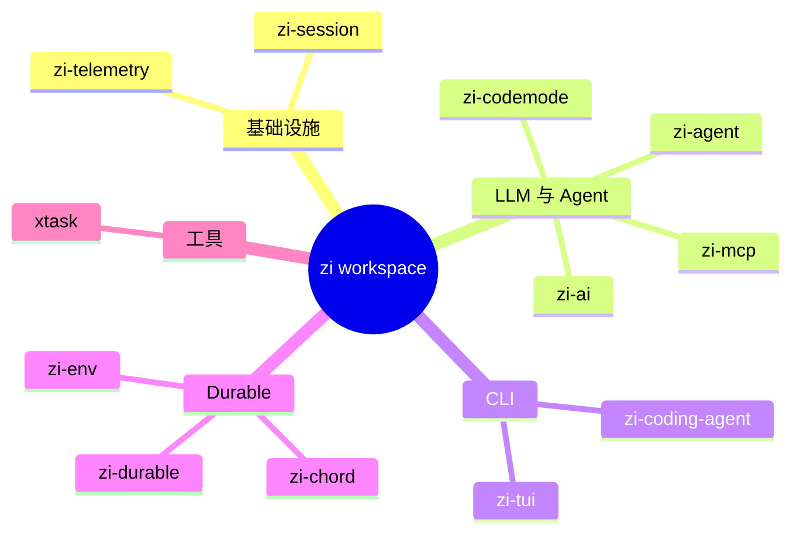
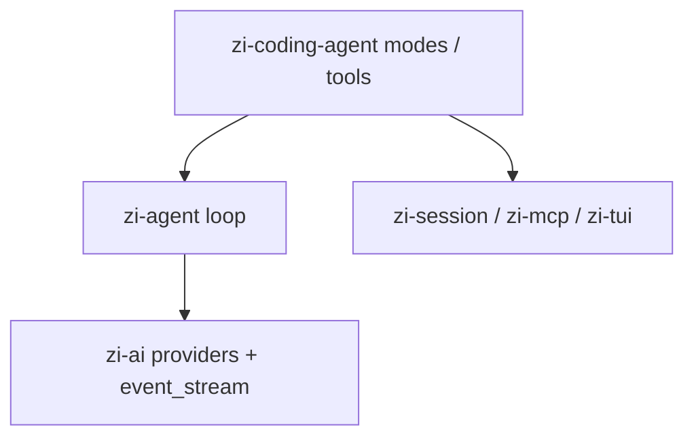

# Crates

Workspace members（`Cargo.toml`）与 pi 源包对照。

## 地图

## 对照表

| Crate | 二进制 / 产物 | pi 源包 | 说明 |
|-------|---------------|---------|------|
| `zi-telemetry` | lib | `packages/telemetry` | NOOP + in-memory；object-safe context |
| `zi-session` | lib | coding-agent session-manager | v3 NDJSON + 迁移 |
| `zi-ai` | lib | `packages/ai` | Anthropic / OpenAI / Google 子集 |
| `zi-agent` | lib | `packages/agent` | 循环、工具、`AgentEvent` |
| `zi-mcp` | lib | `packages/mcp` | stdio + streamable HTTP；可选 `oauth` |
| `zi-codemode` | lib | `packages/codemode` | QuickJS 宿主 |
| `zi-tui` | lib | `packages/tui` | 差分终端 UI |
| `zi-coding-agent` | **`zi`** | `packages/coding-agent` | CLI 模式与工具接线 |
| `zi-chord` | lib + examples | `packages/chord` (v2 next) | host / contracts / store / link |
| `zi-durable` | lib | `packages/durable` | harness 骨架 |
| `zi-env` | **`zi-envd`** | `packages/env` | 帧协议守护进程 + 客户端 |
| `xtask` | bin | （维护） | `check`；`gen-catalog` 规划中 |

## 按层阅读代码

1. CLI 接线：`crates/zi-coding-agent/src/{main,modes,tools}.rs`
2. Agent 循环：`crates/zi-agent/src/agent_loop.rs`
3. Provider：`crates/zi-ai/src/api/`
4. 会话：`crates/zi-session/src/`
5. Durable：`crates/zi-durable/`、`crates/zi-chord/`、`crates/zi-env/`
