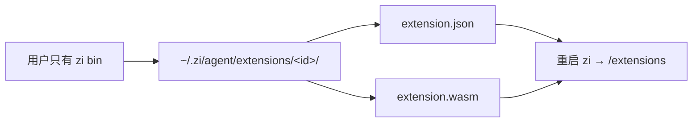
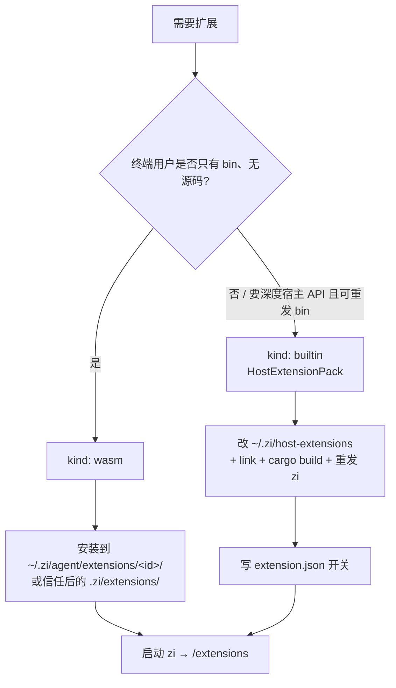
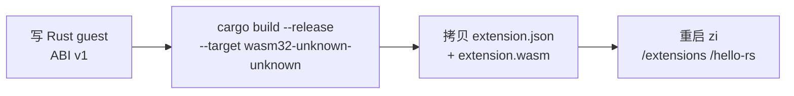

# 扩展开发：从 0 到在 zi 里用上

本文说明如何**从零写一个扩展**，并装进 / 编进 zi 后实际可用。合同细节（manifest 字段、WASM ABI 表）见仓库内 [`.zi/extensions/README.md`](../.zi/extensions/README.md)；路径与环境变量见 [CONFIGURATION.md](./CONFIGURATION.md)。

## 产品前提：用户只有 `zi` 二进制

发给终端用户的是**单个可执行文件**（无 zi / host-extensions 源码）。在这种交付形态下：

| 需求 | 是否满足 | 做法 |
|------|----------|------|
| 不靠源码、用外部目录加扩展 | **是** | 只使用 **WASM**（`kind: wasm`） |
| 配置开关 | **是** | `~/.zi/agent/extensions/<id>/extension.json`（或信任后的项目 `.zi/extensions/`） |
| 动态增加并执行 | **是** | 放入 `extension.json` + `extension.wasm` 后**重启** `zi` |
| 再编一个新的 Rust host pack | **否** | 需维护者改 `zi-host-extensions` 并重发二进制；用户只能开关**已编进 bin 的** builtin |

默认构建已启用 feature `wasm-extensions`（wasmtime），用户拿到的 `zi` 可直接执行外部 `.wasm`。维护者若要瘦身编译可加 `--no-default-features`（此时外部 WASM 仅记录元数据、不执行）。



**用户侧最短路径（无源码）：**

```bash
DEST="$HOME/.zi/agent/extensions/hello"
mkdir -p "$DEST"
# 自备或从作者处取得 extension.json + extension.wasm
cp extension.json extension.wasm "$DEST/"
# 重启 zi，然后：
#   /extensions
#   /hello   # 若该扩展注册了 slash
```

项目目录安装：放到 `<cwd>/.zi/extensions/<id>/`，交互里 `/trust yes` 后再重启。

---

## 先选轨道（作者 / 维护者）



| 轨道 | 代码放哪 | 终端用户 | 何时选 |
|------|----------|----------|--------|
| **WASM** | `extension.wasm` + `extension.json` | 拷到扩展目录；**重启** zi | **唯一**满足「只有 bin」动态加装 |
| **Host pack（builtin）** | `~/.zi/host-extensions`（**构建机**） | 只能开关已内置 id；不能自行加实现 | 维护者发版前编进二进制的一等能力 |

两者都**不**把用户安装物放进 `crates/zi-*`。仓库 `.zi/extensions/` 只是开发样例 / 文档。`~/.zi/host-extensions` **不是**终端用户扩展目录。

运行时发现根：

| 根 | 何时加载 |
|----|----------|
| `~/.zi/agent/extensions/` | 始终 |
| `<cwd>/.zi/extensions/` | 仅 `/trust yes` 之后 |

---

## 完整示例：用 Rust 开发 WASM 扩展

推荐路径：用 Rust 写 guest → 编成 `extension.wasm` → 装到扩展目录 → 重启 `zi` 验证。仓库示例：[`examples/wasm-extension-hello-rs/`](../examples/wasm-extension-hello-rs/)（行为对齐 WAT 版 [`examples/wasm-extension-hello/`](../examples/wasm-extension-hello/)）。



宿主只链接自定义 import 模块 `zi_host`，**没有** WASI。因此目标三元组用 **`wasm32-unknown-unknown`**（不要用依赖 WASI 的 `wasm32-wasip1`）。Guest 必须是 `cdylib`，并导出 `memory`（Rust `cdylib` 默认会导出）。

### 1. 开发：工程与 ABI

示例目录（**独立 crate**，不是 workspace `members`）：

```text
examples/wasm-extension-hello-rs/
  Cargo.toml                 # crate-type = ["cdylib"]
  .cargo/config.toml         # 默认 target = wasm32-unknown-unknown
  src/lib.rs                 # guest 实现
  extension.json             # kind: wasm
  prompts/hello-rs.md        # contributes.prompts
```

`Cargo.toml` 要点：

```toml
[lib]
crate-type = ["cdylib"]

[profile.release]
opt-level = "s"
lto = true
panic = "abort"
```

Guest 侧最少约定（完整表见 [`.zi/extensions/README.md`](../.zi/extensions/README.md)）：

| 方向 | 符号 | 说明 |
|------|------|------|
| export | `zi_extension_init() -> i32` | 返回 `0`；期间调用 `register_*` / `subscribe_hook` |
| export | `zi_alloc(len) -> i32` | 宿主往 guest 线性内存写 JSON 用 |
| export | `zi_on_hook` / `zi_call_command` | 可选；hook / slash |
| import `zi_host` | `register_command` 等 | 参数为 guest 内存里 UTF-8 JSON 的 `(ptr, len)` |

Rust 里用 `#[link(wasm_import_module = "zi_host")]` + `#[no_mangle] pub extern "C"`。`zi_call_command` 的返回值约定：返回指向 **长度前缀**缓冲的指针（前 4 字节 little-endian `u32` 长度 + UTF-8 正文），或 `0` 表示空。

示例 `src/lib.rs` 已实现：init 注册 `/hello-rs`、订阅 `agent_end`、命令返回 `hello from /hello-rs`。可直接改该文件扩展行为。

### 2. 构建 / 编译成 `.wasm`

```bash
# 一次性：安装目标
rustup target add wasm32-unknown-unknown

cd /path/to/zi/examples/wasm-extension-hello-rs
cargo build --release
# 产物（crate 名中的连字符会变成下划线）：
#   target/wasm32-unknown-unknown/release/wasm_extension_hello_rs.wasm
```

可选瘦身（需 [Binaryen](https://github.com/WebAssembly/binaryen) 的 `wasm-opt`）：

```bash
wasm-opt -Os -o extension.wasm \
  target/wasm32-unknown-unknown/release/wasm_extension_hello_rs.wasm
```

不经过本机 `wat2wasm`。WAT 对照版仍可用 `wat2wasm hello.wat -o extension.wasm`（见下节轨道 A）。

### 3. 安装到 zi 发现的位置

**用户级（推荐，不依赖项目 trust）：**

```bash
SRC=/path/to/zi/examples/wasm-extension-hello-rs
DEST="$HOME/.zi/agent/extensions/hello-rs"
mkdir -p "$DEST/prompts"
cp "$SRC/extension.json" "$DEST/"
cp -R "$SRC/prompts/." "$DEST/prompts/"
cp "$SRC/target/wasm32-unknown-unknown/release/wasm_extension_hello_rs.wasm" \
  "$DEST/extension.wasm"
```

**项目级：**

```bash
DEST=".zi/extensions/hello-rs"
# 同样拷贝 extension.json、prompts/、extension.wasm
# 交互里 /trust yes 后才会加载；仍需重启以载入 .wasm 字节
```

`extension.json` 关键字段：

```json
{
  "schemaVersion": 1,
  "id": "hello-rs",
  "kind": "wasm",
  "enabled": true,
  "apiVersion": 1,
  "description": "Minimal WASM ABI v1 guest in Rust",
  "contributes": { "prompts": ["prompts"] },
  "permissions": []
}
```

`apiVersion` 不得大于宿主（当前为 `1`），否则拒绝加载。

### 4. 使用与验证

1. **重启** `zi`（本阶段 **不**热替换 `.wasm` 字节；`/reload` 只重建 host pack / prompts/skills 索引）。
2. `/extensions` — 应看到 `hello-rs [wasm] on`。
3. `/hello-rs` — 应返回 `hello from /hello-rs`（WASM 命令经 `ExtensionHost::dispatch_command` 转发）。
4. 跑一轮对话触发 `agent_end` — 应出现 notify：`hello from rust wasm agent_end`。

### 5. 迭代

| 改什么 | 怎么生效 |
|--------|----------|
| 只改 `enabled` / description / contributes | 编辑 manifest → `/reload`（contributes）或重启 |
| 改 Rust guest 逻辑 | `cargo build --release` → 覆盖 `extension.wasm` → **重启** zi |
| 关扩展 | `"enabled": false` → 重启或下次加载读到新 manifest |

---

## 轨道 A：WASM 扩展（合同与 WAT 备选）

目标：不改、不依赖 zi 源码，只交付 `extension.json` + `extension.wasm`。**Rust 端到端见上一节**；本节补 ABI 摘要与 WAT 组装路径。

### A1. Guest ABI 摘要

Guest 在 `zi_extension_init` 里通过 **import 模块 `zi_host`** 注册能力；payload 为 guest 线性内存里的 UTF-8 JSON `(ptr, len)`。

最少导出：`zi_extension_init() -> i32`、`zi_alloc(len) -> i32`。常用 import：`register_command`、`subscribe_hook`、`ui_notify`、`ui_set_widget`、`emit_log`、`host_api_version`。可选导出：`zi_on_hook`、`zi_call_command`、`zi_call_tool`。完整表见 [`.zi/extensions/README.md`](../.zi/extensions/README.md)。

### A2. 用 WAT 组装（不写 Rust 时）

需要 [WABT](https://github.com/WebAssembly/wabt) 的 `wat2wasm`。参考 [`examples/wasm-extension-hello/`](../examples/wasm-extension-hello/)。

```bash
DEST="$HOME/.zi/agent/extensions/hello"
mkdir -p "$DEST/prompts"
cp extension.json "$DEST/"
cp -R prompts/. "$DEST/prompts/"
wat2wasm hello.wat -o "$DEST/extension.wasm"
# 重启 zi → /extensions → /hello
```

仓库内冒烟（不依赖本机 `wat2wasm`；`wat` 为 dev-dependency）：

```bash
cargo test -p zi-coding-agent wasm_hello -- --nocapture
```

### A3. 开关与更新

- 关：`extension.json` 里 `"enabled": false`。
- 换逻辑：覆盖 `extension.wasm` 后 **重启**。
- `/reload`：重扫 manifest 与 `contributes`；**不会**重载已映射的 WASM 模块字节。

---

## 轨道 B：Host pack（builtin，编进二进制）

目标：在 `~/.zi/host-extensions` 里用 Rust 实现 `HostExtensionPack`，链接进 `zi`，再用 `~/.zi/agent/extensions/<id>/extension.json` 做运行时开关。

### B0. 概念分层

| 层 | 路径 | 何时参与 |
|----|------|----------|
| **实现** | `ZI_HOST_EXTENSIONS_PATH`（默认 `~/.zi/host-extensions`） | **构建期** `cargo build` |
| **链接** | 仓库根 `host-extensions` 符号链接 | `./scripts/link-host-extensions.sh` |
| **开关** | `~/.zi/agent/extensions/<id>/extension.json` | **运行期** discover / `/reload` |

Cargo 的 `path` 依赖读不了环境变量，所以必须先跑 link 脚本（会用 `Cargo.toml.in` 生成带绝对路径的 `Cargo.toml`，避免 workspace 重复成员）。

### B1. 准备构建链路

```bash
# 确认 pack crate 在默认位置（或设 ZI_HOST_EXTENSIONS_PATH）
ls ~/.zi/host-extensions/Cargo.toml.in

cd /path/to/zi
./scripts/link-host-extensions.sh
cargo check -p zi-coding-agent
```

覆盖示例：

```bash
export ZI_HOST_EXTENSIONS_PATH=/elsewhere/zi-host-extensions
# 可选：export ZI_SOURCE_PATH=/path/to/zi
./scripts/link-host-extensions.sh
```

### B2. 在 host-extensions 里实现 pack

对照现有包（`tps` / `redraws` / `prompt-url` / `import-repro`）：

1. 在 `src/ids.rs` 增加稳定 id 常量，并加入 `ALL_BUILTINS`。
2. 新建 `src/packs/<id>/`：实现 `HostExtensionPack`（`id` / `load` / `on_hook`）。
   - `load`：`ctx.subscribe_hook(...)`、`ctx.register_command("name", "summary")`。
   - `on_hook`：读 JSON payload，写 `PackHookEffects`（`notify` / `set_widget` / …）。
3. 在 `src/packs/mod.rs` 的 `instantiate` 里按 id 返回 `Arc<dyn HostExtensionPack>`。
4. 按需在 `lib.rs` 再导出供 `zi-coding-agent` 调用的纯函数（如 `sum_turn_usage`）。

最小 hook 包可参考 `tps`：只订 `AgentEnd`，在 `on_hook` 里 `effects.notify(...)`。

### B3. 在 zi 侧登记「可启用」集合

当前 discover / `PackHost` 对 builtin 使用**显式字段**（`EnabledDevExt::{tps, redraws, …}`），不是任意字符串即插即用。新 id 还需改 `zi-coding-agent`：

1. `dev_ext/discover.rs`：`EnabledDevExt` 增加字段；`from_ids` / `default` / `any` 同步。
2. `dev_ext/pack.rs`：`from_enabled` 里按 id 过滤的 `match` 增加分支。
3. 若新 pack 贡献 **slash**，且行为不能只靠 WASM 那套自动转发：在 `slash.rs` 增加命令处理，并用 `pack_provides(runtime, "cmd")` 做开关（现有 `/tui`、`/ir` 即此模式）。**仅 hook、无新 slash 的包可跳过本步。**

说明：`register_command` 会进入 `/extensions` 列表；真正执行路径上，host pack 的复杂命令目前多为 `slash.rs` 特判，WASM 命令则走 `dispatch_command`。

### B4. 链接、编译、安装开关

```bash
./scripts/link-host-extensions.sh
cargo build -p zi-coding-agent
# 或：cargo run -p zi-coding-agent -- …
```

运行时 manifest（用户可改，**不必**进 zi git）：

```bash
mkdir -p ~/.zi/agent/extensions/my-pack
cat > ~/.zi/agent/extensions/my-pack/extension.json <<'EOF'
{
  "schemaVersion": 1,
  "id": "my-pack",
  "kind": "builtin",
  "enabled": true,
  "apiVersion": 1,
  "description": "my host pack"
}
EOF
```

注意：`id` 必须与 `ids.rs` / `instantiate` 一致。未知 builtin id 会被 discover 警告并忽略。

首次在空的 agent 扩展目录启动时，zi 会按 `ALL_BUILTINS` **seed** 默认 builtin manifest 到 `~/.zi/agent/extensions/`。你已手写过任意 builtin manifest 后，seed 不再覆盖；新包需自己补目录，或清掉旧 builtin 再让 seed 跑（慎用）。

开发样例也可放在仓库 `.zi/extensions/<id>/`（需 `/trust yes` 才加载项目树）。

### B5. 在 zi 里验证

1. 启动刚编好的 `zi`。
2. `/extensions` — `host packs:` 行应含新 id；Manifests 里 `kind=builtin`、`on`。
3. `/reload` — 改 `enabled` 后应能开关 pack（**无需**为 host pack 重启；改的是 Rust 实现则必须重编）。
4. 触发 hook（如跑完一轮看 notify）或调用对应 slash。

### B6. 开关与迭代

| 改什么 | 怎么生效 |
|--------|----------|
| 只改 `enabled` / description | 编辑 manifest → `/reload` |
| 改 pack Rust 逻辑 | 改 `~/.zi/host-extensions` → `link` → `cargo build` → 重启 zi |
| 换 pack 源码目录 | 设 `ZI_HOST_EXTENSIONS_PATH` → 再 `link` → build |

---

## 端到端对照（同一能力两种落地）

以「回合结束提示一条消息」为例：

| 步骤 | WASM | Host pack |
|------|------|-----------|
| 写逻辑 | Rust/WAT→wasm：`subscribe_hook(agent_end)` + `ui_notify`（见 hello-rs 示例） | `TpsPack` 式：`AgentEnd` + `effects.notify` |
| 装到哪 | `~/.zi/agent/extensions/foo/{extension.json,extension.wasm}` | 实现进 host-extensions；开关 json 同上目录、`kind: builtin` |
| 进 zi | 重启（默认 bin 已含 WASM 运行时） | `link-host-extensions.sh` + rebuild + **重发** bin |
| 关掉 | `"enabled": false` 后重启或 `/reload`（manifest）；换 `.wasm` 须重启 | 同左 + `/reload` 即可关 builtin |

---

## 常用命令速查

```bash
# 发布给用户的二进制（默认已含 wasm-extensions）
./scripts/link-host-extensions.sh   # 若本机构建依赖 host packs
cargo build --release -p zi-coding-agent
# 瘦身、不要外部 WASM 执行：cargo build --release -p zi-coding-agent --no-default-features

# 交互里（用户）
/extensions          # 列表 + host packs 摘要
/reload              # 重扫 manifest、重建 host packs、contributes（不热替换 .wasm 字节）
/trust yes           # 允许加载 cwd/.zi/extensions

# WAT 示例冒烟
cargo test -p zi-coding-agent wasm_hello -- --nocapture

# Rust guest → .wasm（独立 crate，非 workspace）
cd examples/wasm-extension-hello-rs && cargo build --release
```

---

## 相关文档

| 文档 | 内容 |
|------|------|
| [`.zi/extensions/README.md`](../.zi/extensions/README.md) | Manifest 合同、ABI 表、作者 checklist |
| [`examples/wasm-extension-hello-rs/`](../examples/wasm-extension-hello-rs/) | **Rust** 最小 guest（开发 / 编译 / 安装主示例） |
| [`examples/wasm-extension-hello/`](../examples/wasm-extension-hello/) | WAT 最小 guest（`wat2wasm`） |
| [CONFIGURATION.md](./CONFIGURATION.md) | `~/.zi/*`、`ZI_HOST_EXTENSIONS_PATH`、`ZI_SOURCE_PATH` |
| [DEVELOPMENT.md](./DEVELOPMENT.md) | 工作区构建与 link 脚本 |
| [COMPAT.md](./COMPAT.md) | 与 pi 扩展模型对照 |
