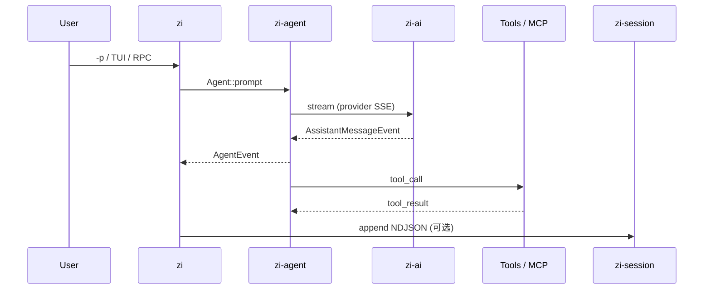

# 入门

## 要求

- Rust **1.85+**（见 workspace `rust-version`）
- Cargo workspace（本仓库根目录）
- 调用真实模型时需要对应 API Key（也可写在 `<cwd>/.env` 或 `~/.zi/agent/.env`）：
  - `ANTHROPIC_API_KEY` / `OPENAI_API_KEY`
  - `DEEPSEEK_API_KEY` / `ZAI_API_KEY` / `OPENROUTER_API_KEY` 等（见 [MODELS.md](./MODELS.md)）

## 构建与运行

```bash
cargo build --workspace
cargo run -p zi-coding-agent -- --help
```

### 单次问答（print）

```bash
export ANTHROPIC_API_KEY=...   # 或写入 .env / 其它 provider key
cargo run -p zi-coding-agent -- -p "Summarize this repo in one sentence." --no-session
```

`--no-session` 避免写入 `~/.zi/agent/sessions/`。

### 指定模型与工作目录

```bash
cargo run -p zi-coding-agent -- \
  --model deepseek-flash \
  --cwd /path/to/project \
  -p "列出主要 crate"
```

自定义端点与更多模型：编辑 `~/.zi/agent/models.json`，见 [MODELS.md](./MODELS.md)。

### 交互模式

```bash
cargo run -p zi-coding-agent -- --mode interactive
# 或：无 -p、stdin 为 TTY 时默认进入 TUI
cargo run -p zi-coding-agent --
```

启动后输入 `/` 查看命令补全；`/model` 列模型，`/hotkeys` 看快捷键，`/quit` 退出。详见 [CLI.md](./CLI.md#interactive（tui）)。

## 运行时数据流（概览）



更多： [CLI](./CLI.md)、[配置](./CONFIGURATION.md)、[架构](./ARCHITECTURE.md)。

## 冒烟检查

```bash
./evals/smoke.sh
```

详见 [evals/README.md](../evals/README.md)。
