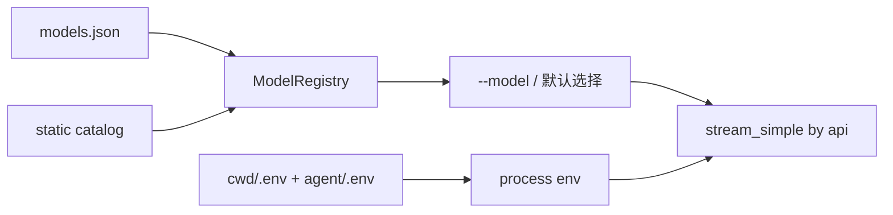

# 模型与 Provider

zi 通过**内置目录** + 用户配置 [`~/.zi/agent/models.json`](./CONFIGURATION.md) 接入模型。协议层复用 `zi-ai` 已有 adapter（Anthropic / OpenAI Completions / OpenAI Responses / Google）；兼容端点一般只需改配置，不必改代码。



## 内置模型（开箱）

| Model id | Provider | API | 环境变量 |
|----------|----------|-----|----------|
| `claude-sonnet-4-20250514` | anthropic | anthropic-messages | `ANTHROPIC_API_KEY` |
| `gpt-4.1` | openai | openai-responses | `OPENAI_API_KEY` |
| `deepseek-flash` | deepseek | openai-completions | `DEEPSEEK_API_KEY`（默认） |
| `deepseek-chat` / `deepseek-reasoner` | deepseek | openai-completions | 同上（见 models.json.example） |
| `glm-4.7-flash` | zai | openai-completions | `ZAI_API_KEY` 或 `GLM_API_KEY`（免费文本） |
| `glm-4v-flash` | zai | openai-completions | 同上（免费图像理解） |
| `openrouter/auto` | openrouter | openai-completions | `OPENROUTER_API_KEY` |

```bash
export DEEPSEEK_API_KEY=sk-...
cargo run -p zi-coding-agent -- --model deepseek-flash -p "你好" --no-session
```

未知 `--model` id 会**报错退出**（不再静默回退）。

未指定 `--model` 时，优先使用 `~/.zi/agent/settings.json` 里的 `defaultModel`（上次 `/model` 切换或启动时记住的 id）；无效再回退到「有密钥的第一个模型」。

## 密钥：`.env` 与 `$ENV`

启动时自动加载（**不覆盖**已有进程环境变量）：

1. `<cwd>/.env`（项目，优先）
2. `~/.zi/agent/.env`（或 `$ZI_AGENT_DIR/.env`）

```bash
# ~/.zi/agent/.env 或项目 .env
DEEPSEEK_API_KEY=sk-...
ZAI_API_KEY=...
```

`.env` 含密钥，勿提交到 git。

`models.json` 里 `"apiKey": "$DEEPSEEK_API_KEY"` 或 `"${DEEPSEEK_API_KEY}"` 表示读进程环境（含 `.env` 注入后的值）。也可写字面量（不推荐）。

优先级：显式 stream `api_key` → `models.json` 的 `apiKey` → 进程 env。

## 自定义端点：`models.json`

路径：`~/.zi/agent/models.json`（可用 `ZI_AGENT_DIR` 覆盖根目录）。仓库根目录有示例 [`models.json.example`](../models.json.example)：

```bash
mkdir -p ~/.zi/agent
cp models.json.example ~/.zi/agent/models.json
```

字段与 pi 的 models.json **子集**对齐（camelCase）。Provider：`baseUrl`、`api`、`apiKey`、`models[]`。Model：`id`（必填）、`name`、`api`、`baseUrl`、`reasoning`、`contextWindow`、`maxTokens`、`cost`。

### DeepSeek（覆盖 / 加模型）

```json
{
  "providers": {
    "deepseek": {
      "baseUrl": "https://api.deepseek.com",
      "api": "openai-completions",
      "apiKey": "$DEEPSEEK_API_KEY",
      "models": [
        {
          "id": "deepseek-flash",
          "name": "DeepSeek Flash",
          "reasoning": true,
          "contextWindow": 1000000,
          "maxTokens": 64000
        }
      ]
    }
  }
}
```

### 智谱 GLM / Z.AI

```json
{
  "providers": {
    "zai": {
      "baseUrl": "https://open.bigmodel.cn/api/paas/v4",
      "api": "openai-completions",
      "apiKey": "$ZAI_API_KEY",
      "models": [
        { "id": "glm-4.7-flash", "name": "GLM-4.7-Flash", "contextWindow": 200000 },
        { "id": "glm-4v-flash", "name": "GLM-4V-Flash", "contextWindow": 16000, "maxTokens": 1024 }
      ]
    }
  }
}
```

### OpenRouter

```json
{
  "providers": {
    "openrouter": {
      "baseUrl": "https://openrouter.ai/api/v1",
      "api": "openai-completions",
      "apiKey": "$OPENROUTER_API_KEY",
      "models": [
        { "id": "anthropic/claude-sonnet-4", "contextWindow": 200000 }
      ]
    }
  }
}
```

### Ollama（本地）

```json
{
  "providers": {
    "ollama": {
      "baseUrl": "http://localhost:11434/v1",
      "api": "openai-completions",
      "apiKey": "ollama",
      "models": [{ "id": "qwen2.5-coder:7b" }]
    }
  }
}
```

### 仅改代理 baseUrl

内置模型与认证不变，只改端点：

```json
{
  "providers": {
    "anthropic": { "baseUrl": "https://proxy.example.com" }
  }
}
```

## 何时仍需改代码

仅当厂商协议**不是**下列之一时：`anthropic-messages`、`openai-completions`、`openai-responses`、`google-generative-ai`。那时需在 `zi-ai` 增加 adapter 与 `KnownApi` 变体。

与 pi 的完整 `compat` / `headers` / `!command` / `auth.json` 尚未对齐，见 [COMPAT.md](./COMPAT.md)。
