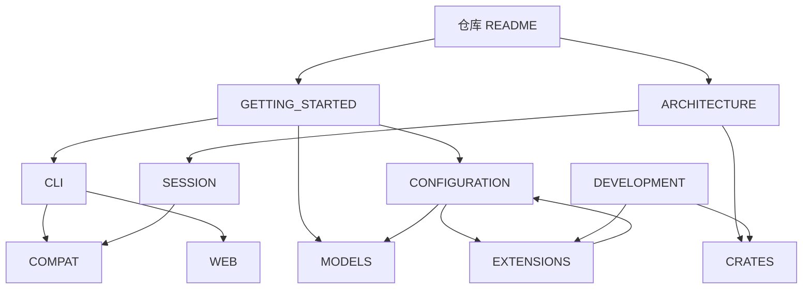

# zi 技术文档

本目录维护 **zi** 的架构说明、使用方式与协议约定。根目录 [README](../README.md) 只保留概览与入口链接。

## 文档地图

| 文档 | 读者 | 说明 |
|------|------|------|
| [GETTING_STARTED.md](./GETTING_STARTED.md) | 新用户 | 依赖、密钥、第一次 `zi` |
| [ARCHITECTURE.md](./ARCHITECTURE.md) | 贡献者 | 双路径、依赖与事件流（Mermaid） |
| [CLI.md](./CLI.md) | 使用者 | print / json / rpc / interactive / web |
| [WEB.md](./WEB.md) | 使用者 / 前端 | Web 宿主、token 登录、REST/WS 合同 |
| [CONFIGURATION.md](./CONFIGURATION.md) | 使用者 | 路径与环境变量 |
| [EXTENSIONS.md](./EXTENSIONS.md) | 扩展作者 | 从 0 开发 WASM（含 Rust→`.wasm` 示例）/ host pack 到在 zi 里使用 |
| [MODELS.md](./MODELS.md) | 使用者 | 内置模型、`.env`、`models.json` |
| [CRATES.md](./CRATES.md) | 贡献者 | crate 地图与 pi 对照 |
| [SESSION.md](./SESSION.md) | 贡献者 | Session v3 NDJSON |
| [COMPAT.md](./COMPAT.md) | 集成方 | 与 pi 的协议对齐 |
| [DEVELOPMENT.md](./DEVELOPMENT.md) | 贡献者 | 构建、测试、镜像、xtask |

相关目录：

- [`evals/`](../evals/README.md) — 冒烟与 fixture
- [`xtask/`](../xtask/README.md) — 工作区维护任务
- [`.zi/extensions/`](../.zi/extensions/README.md) — manifest / ABI 合同与样例

## 维护约定

1. **流程与架构图优先用 Mermaid**（`flowchart` / `sequenceDiagram` / `graph`），避免 ASCII 框线图成为唯一来源。
2. 根 README 不重复长表格；细节放到本目录并互相链接。
3. 与 pi 的合同变更同步更新 [COMPAT.md](./COMPAT.md)；实现变更同步 [ARCHITECTURE.md](./ARCHITECTURE.md) / [CRATES.md](./CRATES.md)。
4. 标识符、crate 名、环境变量、命令保持英文原文；叙述可用中文。
