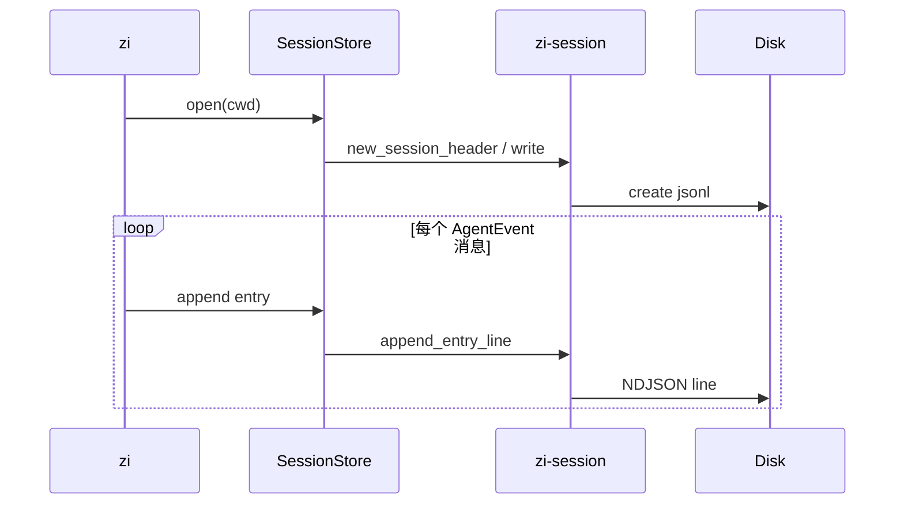
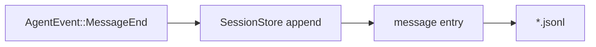

# Session v3

`zi-session` 读写与 pi 对齐的 **session v3** NDJSON：首行 `session` header，其后为树状 entry。

完整合同参考 pi：[session-format.md](https://github.com/earendil-works/pi/blob/main/packages/coding-agent/docs/session-format.md)。

## 文件生命周期



## 路径

```text
$ZI_AGENT_DIR/sessions/--<encoded-cwd>--/<timestamp>_<session-id>.jsonl
```

默认 `ZI_AGENT_DIR` → `~/.zi/agent`。编码规则与 pi 相同。

## 行类型（摘要）

| `type` | 含义 |
|--------|------|
| `session` | Header（`version: 3`） |
| `message` | 用户 / 助手 / toolResult 等 |
| `model_change` | 模型切换 |
| `compaction` | 压缩标记 |
| … | 见 `zi_session::SessionEntry` |

## 迁移

加载 v1/v2 时会就地迁移（例如 `hookMessage` → `custom`）。API：`migrate_session_entries`、`load_entries_from_path`。

## Fixture

```text
evals/fixtures/session_v3_sample.jsonl
```

最小有效文件：header + user message + `model_change`。

## 与 Agent 的关系



`--no-session` 时跳过写入。协议字段对齐见 [COMPAT.md](./COMPAT.md#session-v3-ndjson)。
